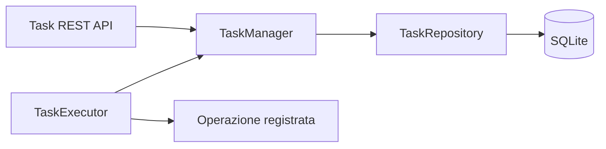

# 01–08 — Fondamenta e Task Engine

[Indice](README.md) · [Progetto](../../README.md)

**Stato: IMPLEMENTATE le capacita descritte; numerazione individuale 01–08 DA VERIFICARE.**

## Obiettivo e contesto

Ricostruzione dei primi otto commit prima della 09.1. Il README era vuoto fino alla 09.1: non esiste una fonte versionata che assegni un numero a ciascuna fase. Le otto sottosezioni seguenti seguono i commit, senza dichiararle milestone numerate originarie.

## Decisioni e tradeoff

Sono osservabili una macchina a stati esplicita, snapshot isolati, separazione manager/repository/executor e un percorso sincrono. In memoria si ottiene semplicita ma non durata; SQLite aggiunge durata e transazioni ma non una coda distribuita. Queste sono conseguenze tecniche ricostruite, non motivazioni storiche verbalizzate. Confronti formalizzati con altri database/framework, criteri di scelta e alternative scartate: **non documentato**.

## Fase: Bootstrap FastAPI e configurazione

Commit `b2712331cb216a887b686391e15bc8cda29f1885` — chore: initialize JACK backend with FastAPI and tests.

### Componenti, contratti e flusso

GET /health restituisce status, service e version. Settings carica .env e get_settings usa cache.

### Persistenza, sicurezza e limiti

Nessun database in questa fase; health non verifica la connettivita DB. Le API non introducono autenticazione/RBAC; la validazione strutturale non e un controllo di autorizzazione.

### Fonti e test

- [backend/app/__init__.py](../../backend/app/__init__.py)
- [backend/app/config.py](../../backend/app/config.py)
- [backend/app/main.py](../../backend/app/main.py)
- [backend/tests/test_config.py](../../backend/tests/test_config.py)
- [backend/tests/test_health.py](../../backend/tests/test_health.py)

Per distinguere il comportamento iniziale da quello attuale, leggere questi percorsi con `git show b2712331cb216a887b686391e15bc8cda29f1885:<percorso>`. I test attestano i casi codificati, non una garanzia generale di esecuzione exactly-once o di sicurezza del codice eseguito.

## Fase: Modelli Task e macchina a stati

Commit `fc5d64d9319d0cf5f2d8646a5a0fa316fd481517` — feat: add task models and state machine.

### Componenti, contratti e flusso

Task ha UUID, titolo, descrizione, priorita e risultato opzionale. pending -> running -> completed/failed; stati finali terminali.

### Persistenza, sicurezza e limiti

Pydantic vieta campi extra e valida assegnazioni. Nessuna migrazione. Le API non introducono autenticazione/RBAC; la validazione strutturale non e un controllo di autorizzazione.

### Fonti e test

- [backend/app/tasks/__init__.py](../../backend/app/tasks/__init__.py)
- [backend/app/tasks/models.py](../../backend/app/tasks/models.py)
- [backend/app/tasks/state_machine.py](../../backend/app/tasks/state_machine.py)
- [backend/tests/test_task_models.py](../../backend/tests/test_task_models.py)
- [backend/tests/test_task_state_machine.py](../../backend/tests/test_task_state_machine.py)

Per distinguere il comportamento iniziale da quello attuale, leggere questi percorsi con `git show fc5d64d9319d0cf5f2d8646a5a0fa316fd481517:<percorso>`. I test attestano i casi codificati, non una garanzia generale di esecuzione exactly-once o di sicurezza del codice eseguito.

## Fase: TaskManager in memoria

Commit `09f5dea4b8c51f8b393593c36f0f1eaada0f0f6f` — feat: implement in-memory task manager.

### Componenti, contratti e flusso

create_task/get_task/list_tasks/update_status operano su dizionario UUID -> Task. Copie profonde isolano gli snapshot restituiti.

### Persistenza, sicurezza e limiti

Stato volatile perso al riavvio; nessuna garanzia di coordinamento fra processi. Le API non introducono autenticazione/RBAC; la validazione strutturale non e un controllo di autorizzazione.

### Fonti e test

- [backend/app/tasks/manager.py](../../backend/app/tasks/manager.py)
- [backend/tests/test_task_manager.py](../../backend/tests/test_task_manager.py)

Per distinguere il comportamento iniziale da quello attuale, leggere questi percorsi con `git show 09f5dea4b8c51f8b393593c36f0f1eaada0f0f6f:<percorso>`. I test attestano i casi codificati, non una garanzia generale di esecuzione exactly-once o di sicurezza del codice eseguito.

## Fase: REST API task

Commit `e8b69a65d965c5c882f9a1b6e252a3e22629a16c` — feat: expose task management REST API.

### Componenti, contratti e flusso

POST /tasks crea (201); GET /tasks elenca; GET /tasks/{task_id} legge. Risorsa assente 404, validazione input 422.

### Persistenza, sicurezza e limiti

Il router iniziale usa il manager in memoria; non retroattribuire il DB alla prima API. Le API non introducono autenticazione/RBAC; la validazione strutturale non e un controllo di autorizzazione.

### Fonti e test

- [backend/app/main.py](../../backend/app/main.py)
- [backend/app/tasks/router.py](../../backend/app/tasks/router.py)
- [backend/tests/test_task_api.py](../../backend/tests/test_task_api.py)

Per distinguere il comportamento iniziale da quello attuale, leggere questi percorsi con `git show e8b69a65d965c5c882f9a1b6e252a3e22629a16c:<percorso>`. I test attestano i casi codificati, non una garanzia generale di esecuzione exactly-once o di sicurezza del codice eseguito.

## Fase: Endpoint aggiornamento stato

Commit `6577f0a35b20150ff577945301cea6d0b010def8` — feat: add task status update endpoint.

### Componenti, contratti e flusso

PATCH /tasks/{task_id}/status riceve status; transizioni vietate 409, task assente 404.

### Persistenza, sicurezza e limiti

Non esegue operazioni: aggiorna solo il lifecycle ammesso. Le API non introducono autenticazione/RBAC; la validazione strutturale non e un controllo di autorizzazione.

### Fonti e test

- [backend/app/tasks/router.py](../../backend/app/tasks/router.py)
- [backend/tests/test_task_api.py](../../backend/tests/test_task_api.py)

Per distinguere il comportamento iniziale da quello attuale, leggere questi percorsi con `git show 6577f0a35b20150ff577945301cea6d0b010def8:<percorso>`. I test attestano i casi codificati, non una garanzia generale di esecuzione exactly-once o di sicurezza del codice eseguito.

## Fase: Persistenza SQLAlchemy/Alembic

Commit `b2473813bbff0f3b631bef3f9188a486e7e47103` — feat: add persistent task storage with SQLAlchemy and Alembic.

### Componenti, contratti e flusso

TaskRepository separa SQL dal manager. La dependency FastAPI apre una sessione per richiesta. SQLite locale backend/jack.db.

### Persistenza, sicurezza e limiti

9037f069938f crea tasks con id/title/description/status/priority/result; downgrade elimina la tabella. Manager mantiene anche il backend in memoria. Le API non introducono autenticazione/RBAC; la validazione strutturale non e un controllo di autorizzazione.

### Fonti e test

- [backend/alembic/env.py](../../backend/alembic/env.py)
- [backend/alembic/versions/9037f069938f_create_tasks_table.py](../../backend/alembic/versions/9037f069938f_create_tasks_table.py)
- [backend/app/db/__init__.py](../../backend/app/db/__init__.py)
- [backend/app/db/base.py](../../backend/app/db/base.py)
- [backend/app/db/session.py](../../backend/app/db/session.py)
- [backend/app/tasks/db_models.py](../../backend/app/tasks/db_models.py)
- [backend/app/tasks/manager.py](../../backend/app/tasks/manager.py)
- [backend/app/tasks/repository.py](../../backend/app/tasks/repository.py)
- [backend/app/tasks/router.py](../../backend/app/tasks/router.py)
- [backend/tests/test_task_api.py](../../backend/tests/test_task_api.py)
- [backend/tests/test_task_db_models.py](../../backend/tests/test_task_db_models.py)
- [backend/tests/test_task_manager_db.py](../../backend/tests/test_task_manager_db.py)
- [backend/tests/test_task_repository.py](../../backend/tests/test_task_repository.py)

Per distinguere il comportamento iniziale da quello attuale, leggere questi percorsi con `git show b2473813bbff0f3b631bef3f9188a486e7e47103:<percorso>`. I test attestano i casi codificati, non una garanzia generale di esecuzione exactly-once o di sicurezza del codice eseguito.

## Fase: Execution engine e operation registry

Commit `96c832d4deeb5c2b7496befa66528c265991eb0a` — feat: add task execution engine and operation registry.

### Componenti, contratti e flusso

TaskExecutor esegue Callable senza argomenti e restituisce Task. OperationRegistry risolve nomi espliciti; POST /tasks/{task_id}/execute riceve operation.

### Persistenza, sicurezza e limiti

Operazione sconosciuta 400; fallimento esecuzione 500. Il risultato resta testo; nessuna coda distribuita o sandbox. Le API non introducono autenticazione/RBAC; la validazione strutturale non e un controllo di autorizzazione.

### Fonti e test

- [backend/app/tasks/executor.py](../../backend/app/tasks/executor.py)
- [backend/app/tasks/manager.py](../../backend/app/tasks/manager.py)
- [backend/app/tasks/operations.py](../../backend/app/tasks/operations.py)
- [backend/app/tasks/registry.py](../../backend/app/tasks/registry.py)
- [backend/app/tasks/router.py](../../backend/app/tasks/router.py)
- [backend/tests/test_operation_registry.py](../../backend/tests/test_operation_registry.py)
- [backend/tests/test_task_api.py](../../backend/tests/test_task_api.py)
- [backend/tests/test_task_executor.py](../../backend/tests/test_task_executor.py)
- [backend/tests/test_task_manager.py](../../backend/tests/test_task_manager.py)
- [backend/tests/test_task_manager_db.py](../../backend/tests/test_task_manager_db.py)

Per distinguere il comportamento iniziale da quello attuale, leggere questi percorsi con `git show 96c832d4deeb5c2b7496befa66528c265991eb0a:<percorso>`. I test attestano i casi codificati, non una garanzia generale di esecuzione exactly-once o di sicurezza del codice eseguito.

## Fase: Affidabilita, recovery e transizioni atomiche

Commit `26c3efcb8c7f80e011df48849fdc8d9deee9abad` — feat(tasks): harden execution, recovery and atomic transitions.

### Componenti, contratti e flusso

Claim pending e finalizzazione running condizionali evitano aggiornamenti persi nel repository. Conflitti distinguibili dagli errori operativi; ExceptionGroup conserva le due cause se falliscono operazione e finalizzazione.

### Persistenza, sicurezza e limiti

TaskRecovery marca running come failed con messaggio di interruzione; startup solo con JACK_RECOVER_ON_STARTUP=1. Nessun retry automatico; nessun heartbeat/lease: non attivare recovery su worker ancora vivi. Nessuna nuova migrazione. Le API non introducono autenticazione/RBAC; la validazione strutturale non e un controllo di autorizzazione.

### Fonti e test

- [backend/app/main.py](../../backend/app/main.py)
- [backend/app/tasks/executor.py](../../backend/app/tasks/executor.py)
- [backend/app/tasks/manager.py](../../backend/app/tasks/manager.py)
- [backend/app/tasks/recovery.py](../../backend/app/tasks/recovery.py)
- [backend/app/tasks/repository.py](../../backend/app/tasks/repository.py)
- [backend/app/tasks/router.py](../../backend/app/tasks/router.py)
- [backend/tests/test_startup_recovery.py](../../backend/tests/test_startup_recovery.py)
- [backend/tests/test_task_api.py](../../backend/tests/test_task_api.py)
- [backend/tests/test_task_executor.py](../../backend/tests/test_task_executor.py)
- [backend/tests/test_task_manager.py](../../backend/tests/test_task_manager.py)
- [backend/tests/test_task_recovery.py](../../backend/tests/test_task_recovery.py)
- [backend/tests/test_task_repository.py](../../backend/tests/test_task_repository.py)

Per distinguere il comportamento iniziale da quello attuale, leggere questi percorsi con `git show 26c3efcb8c7f80e011df48849fdc8d9deee9abad:<percorso>`. I test attestano i casi codificati, non una garanzia generale di esecuzione exactly-once o di sicurezza del codice eseguito.

## Modelli e flusso attuale del Task Engine

La priorita del task e un dato del modello: non e uno scheduler. Un claim unico non rende atomici eventuali effetti esterni dell'operazione e la scrittura del risultato.

## Evoluzione e lacune

La [09.1](09.1-multi-agent-foundation.md) aggiunge il contratto agente sopra queste fondamenta. La catena migrazioni e in [SOURCES.md](SOURCES.md). Conteggi dei test al momento di ciascuna fase, milestone originali individuali, motivazioni non espresse e discussioni precedenti al primo commit: **non documentato**.
