# Milestone JACK

[Progetto](../../README.md) · [Fonti e lacune](SOURCES.md) · [Template](TEMPLATE.md) · [Verifiche](VERIFICATION.md)

Baseline storica: `2d75ebd4258e64b5da888bf85d54de53da372104`, 11 novembre 2026. Aggiornamento del 22 novembre: aggiunta la 10.2 v1 per prototipi statici da piani approvati; sviluppo applicativo generale ed esecuzione restano futuri. Nessuna percentuale di completamento del prodotto e deducibile dal numero di milestone.

| Milestone | Contenuto | Stato |
| --- | --- | --- |
| [01–08](01-08-core-infrastructure.md) | Fondamenta e Task Engine | IMPLEMENTATE; numerazione da verificare |
| [09.1](09.1-multi-agent-foundation.md) | Multi-Agent Foundation | IMPLEMENTATA |
| [09.2](09.2-agent-orchestration.md) | Agent Orchestration | IMPLEMENTATA |
| [09.3](09.3-business-research.md) | Business Research | IMPLEMENTATA |
| [09.4](09.4-internet-research.md) | Internet Research | IMPLEMENTATA |
| [09.5](09.5-commercial-intelligence.md) | Commercial Intelligence | IMPLEMENTATA |
| [09.6](09.6-business-validation.md) | Business Validation | IMPLEMENTATA |
| [09.7](09.7-business-portfolio.md) | Business Portfolio | IMPLEMENTATA |
| [09.8](09.8-portfolio-decisions.md) | Portfolio Decision Engine | IMPLEMENTATA |
| [10.1](10.1-execution-planner.md) | Execution Planner | IMPLEMENTATA |
| [10.2](10.2-development-agent.md) | Development Agent | IMPLEMENTATA V1: prototipi statici |
| [10.3](10.3-sandbox-execution-runtime.md) | Sandbox & Execution Runtime | PROPOSTA / FUTURA |
| [10.4](10.4-qa-security-agent.md) | QA & Security Agent | PROPOSTA / FUTURA |
| [10.5](10.5-deployment-agent.md) | Deployment Agent | PROPOSTA / FUTURA |
| [10.6](10.6-product-lifecycle-manager.md) | Product Lifecycle Manager | PROPOSTA / FUTURA |
| [11.1](11.1-pricing-intelligence.md) | Pricing Intelligence | PROPOSTA / FUTURA |
| [11.2](11.2-payments-subscriptions.md) | Payments & Subscriptions | PROPOSTA / FUTURA |
| [11.3](11.3-growth-agent.md) | Growth Agent | PROPOSTA / FUTURA |
| [11.4](11.4-marketing-automation.md) | Marketing Automation | PROPOSTA / FUTURA |
| [11.5](11.5-customer-support-agent.md) | Customer Support Agent | PROPOSTA / FUTURA |
| [11.6](11.6-revenue-analytics.md) | Revenue Analytics | PROPOSTA / FUTURA |
| [12.1](12.1-business-operations-agent.md) | Business Operations Agent | PROPOSTA / FUTURA |
| [12.2](12.2-financial-intelligence.md) | Financial Intelligence | PROPOSTA / FUTURA |
| [12.3](12.3-capital-allocation-engine.md) | Capital Allocation Engine | PROPOSTA / FUTURA |
| [12.4](12.4-risk-management-engine.md) | Risk Management Engine | PROPOSTA / FUTURA |
| [12.5](12.5-autonomous-decision-policies.md) | Autonomous Decision Policies | PROPOSTA / FUTURA |
| [12.6](12.6-business-scaling-shutdown.md) | Business Scaling & Shutdown | PROPOSTA / FUTURA |
| [13](13-continuous-opportunity-discovery.md) | Continuous Opportunity Discovery | PROPOSTA / FUTURA |
| [14](14-portfolio-optimization.md) | Portfolio Optimization | PROPOSTA / FUTURA |
| [15](15-autonomous-business-ecosystem.md) | Autonomous Business Ecosystem | PROPOSTA / FUTURA |

## Come leggere e aggiornare

01–08 raccoglie otto fasi comprovate dai commit senza inventare la numerazione individuale. Le pagine 09.1–10.1 conservano i dettagli del README precedente e della specifica planner. I percorsi al codice puntano alla versione corrente; il commit in ogni documento identifica lo snapshot storico. «Non documentato» indica assenza di prova; «da verificare» indica un'informazione ancora da confermare.

Le pagine future sono schede di proposta, senza endpoint o migrazioni inventati. Prima di promuoverle usare il template e aggiungere prove concrete, alternative effettivamente valutate, commit e verifiche.

## Requisiti trasversali proposti

Identity & Permissions, Observability & Cost Control ed Evaluation Framework provengono dalla proposta in chat e non sono milestone numerate implementate. Occorre definire identita autentiche, permessi specifici, revoche, tracciamento costi e valutazioni riproducibili prima di concedere autonomia. L'attuale actor dichiarato non e autenticazione. Un pilota con clienti reali, approvato e misurato, dovra verificare interesse e risultati: la roadmap non dimostra redditivita.

```mermaid
flowchart LR
  Task[01-08 Task Engine] --> Agents[09.1-09.2 Agenti e workflow]
  Agents --> Research[09.3-09.5 Ricerca]
  Research --> Validation[09.6 Validazione]
  Validation --> Portfolio[09.7 Portafoglio]
  Portfolio --> Decision[09.8 Decisioni consultive]
  Decision --> Planner[10.1 Piano MVP]
  Planner --> Prototype[10.2 v1 Prototipo statico locale]
  Prototype -. proposta futura .-> Build[10.3-10.6 Runtime QA e release]
  Build -. proposta futura .-> Growth[11.x Monetizzazione]
  Growth -. proposta futura .-> Operations[12.x Operazioni e politiche]
  Operations -. proposta futura .-> Ecosystem[13-15 Evoluzione integrata]
```

